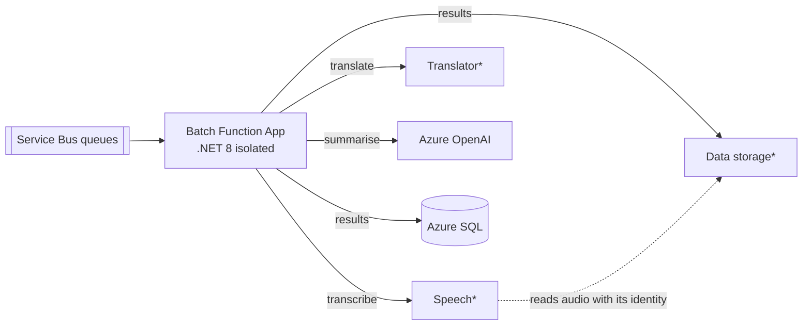

# terraform-azurerm-ai-stt-batch

[](https://github.com/goosain-platform-lab/terraform-azurerm-ai-stt-batch/actions/workflows/ci.yml)

Terraform module for the **batch side of a speech-to-text workload**: a queue-driven pipeline that transcribes recordings, translates them, summarises them with Azure OpenAI and stores the results. It is **secretless**, like the rest of the lab.

It plugs into the real-time module [terraform-azurerm-ai-stt](https://github.com/goosain-platform-lab/terraform-azurerm-ai-stt). It reuses that module's Speech, Translator, data storage, Key Vault and (optionally) App Service plan, so the two can be released and deployed independently.

## What this demonstrates

- **Event-driven design:** one Service Bus queue per pipeline stage, processed by an isolated .NET Function App.
- **Module composition:** plugs into the real-time module's `shared_services` output and can share its App Service plan. Its input contract is enforced with cross-variable validation.
- **Secretless by default:** identity-based Functions host storage and Service Bus trigger, Entra-only SQL, and Speech reads the audio with its own managed identity.
- **CI quality gates:** `terraform validate` runs against the real-time module at its released tag, plus tflint and Checkov.

**Status:** validated in CI; not deployed, to avoid running costs.

## What it deploys


<sub>\* owned by the real-time module, passed in through `shared_services`</sub>

| Component | Resource | Default SKU |
|---|---|---|
| Pipeline | Windows Function App (.NET 8 isolated) | Shares the real-time B1 plan, or creates its own |
| Messaging | Service Bus: 4 queues (`transcription-requests`, `translation-requests`, `summarization-requests`, `pipeline-tasks`) + topic `pipeline-events` | Premium, 1 MU |
| Results | Azure SQL database (Entra-only) | S0 |
| Summaries (optional) | Azure OpenAI | S0 |
| Functions host | Storage account (identity-based, private) | Standard LRS |
| Telemetry | Application Insights → your Log Analytics workspace | — |

Names follow `<type>-<workload>-<component>-<environment>-<region>`, for example `func-stt-batch-lab-zan`, `sbns-stt-batch-lab-zan` and `sql-stt-batch-lab-zan`.

## Secretless by design

| Common pattern | This module |
|---|---|
| `AzureWebJobsStorage` connection string | Shared keys disabled; identity-based host storage (`AzureWebJobsStorage__accountName/__credential/__clientId`) |
| Service Bus SAS connection string | Local auth disabled; identity-based trigger (`ServiceBusConnection__fullyQualifiedNamespace`) |
| SQL admin login and password | Entra-only SQL; `Sql__ConnectionString` uses `Authentication=Active Directory Managed Identity` |
| Speech, Translator and OpenAI keys | Key auth disabled; RBAC roles on the Function App's identity |
| SAS URLs for batch transcription | The Speech resource reads the audio with its own managed identity (**Storage Blob Data Reader**) |

## Setup

The Azure and HCP Terraform setup is the same as the real-time module. Run its [bootstrap script](scripts/bootstrap-azure.ps1) with `-Workspaces ai-stt-batch-lab`, then:

1. Create HCP workspace `ai-stt-batch-lab` with working directory `examples/with-stt`, plus the four environment variables the script prints.
2. **Terraform variables:** set `sql_entra_admin` (HCL) and, optionally, `openai_deployments`. See [`terraform.tfvars.example`](examples/with-stt/terraform.tfvars.example).
3. The example pulls the real-time module at `v0.1.0`, so that tag must exist first. Then plan and apply.

### Post-deployment: grant the identity access to SQL

SQL users can't be created through Azure Resource Manager, so this is a one-off step. Connect to the database as a member of the admin group, from inside the VNet, and run:

```sql
-- Values from the outputs: batch.identity.name and batch.identity.principal_id
CREATE USER [id-stt-batch-lab-zan] FROM EXTERNAL PROVIDER WITH OBJECT_ID = '<principal_id>';
ALTER ROLE db_datareader ADD MEMBER [id-stt-batch-lab-zan];
ALTER ROLE db_datawriter ADD MEMBER [id-stt-batch-lab-zan];
ALTER ROLE db_ddladmin  ADD MEMBER [id-stt-batch-lab-zan];  -- only if the app runs migrations
```

### Deploying the function code

The Function App is private-only. Deploy from one of:
- a VNet-connected runner (GitHub-hosted runners with Azure private networking, or self-hosted);
- the landing zone's jumpbox;
- a temporary SCM access rule for the runner, removed afterwards.

### If batch transcription can't read the audio

The data storage account is fully private. Speech reaches it as a trusted Azure service using its managed identity. If transcription jobs report access errors in your region, change the data account to **Enabled from selected networks**, add the Speech resource as a resource instance rule, and keep the default action **Deny**.

## App code requirements

| Setting | Use |
|---|---|
| `ServiceBusConnection__*` | Service Bus trigger connection (already identity-based) |
| `Queues__<name>` | Queue names, so code doesn't hard-code them |
| `Speech__Endpoint`, `Speech__ResourceId` | Speech with a `TokenCredential` |
| `Translator__Endpoint` | Translator with an Entra bearer token |
| `OpenAI__Endpoint` | Azure OpenAI with `DefaultAzureCredential` |
| `Storage__BlobServiceUri` | Blob access with `DefaultAzureCredential` |
| `Sql__ConnectionString` | SQL with managed identity, no password |

## Cost

**Service Bus Premium** is the main fixed cost, plus six to eight private endpoints. For short sessions, use [`low-cost.tfvars.example`](examples/with-stt/low-cost.tfvars.example) (Service Bus Standard, no OpenAI) and run `terraform destroy` afterwards.

## Module reference

**Required inputs:**
- `location`, `resource_group_name`, `app_subnet_id`, `private_endpoint_subnet_id`, `log_analytics_workspace_id`
- `private_dns_zone_ids` (keys `blob`, `file`, `queue`, `table`, `sites`, `servicebus`, `sql`, `openai`)
- from the real-time module's `shared_services`: `speech_account_id`, `speech_endpoint`, `speech_principal_id`, `translator_account_id`, `translator_endpoint`, `data_storage_account_id`, `data_blob_endpoint`

**Sharing the real-time plan:** set `create_app_service_plan = false` and pass `app_service_plan_id`. The Function App must then be in the plan's resource group (validated).

**Outputs:** `identity`, `function_app`, `service_bus`, `sql`, `openai_endpoint`.
